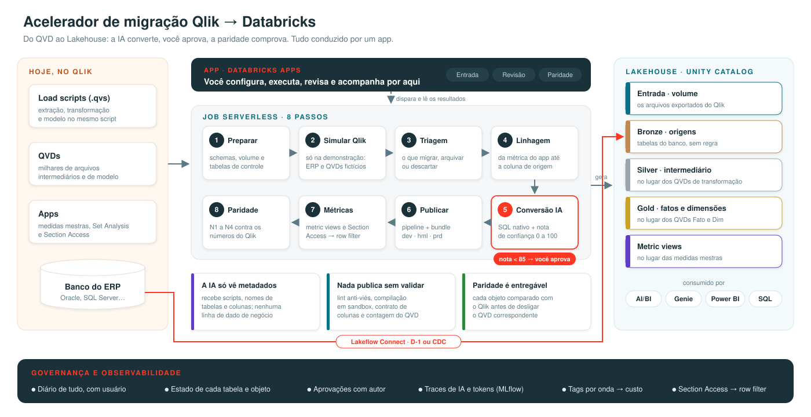
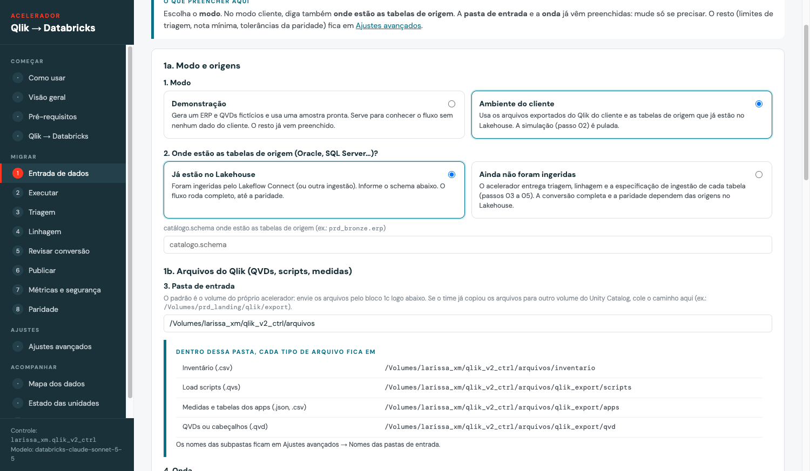
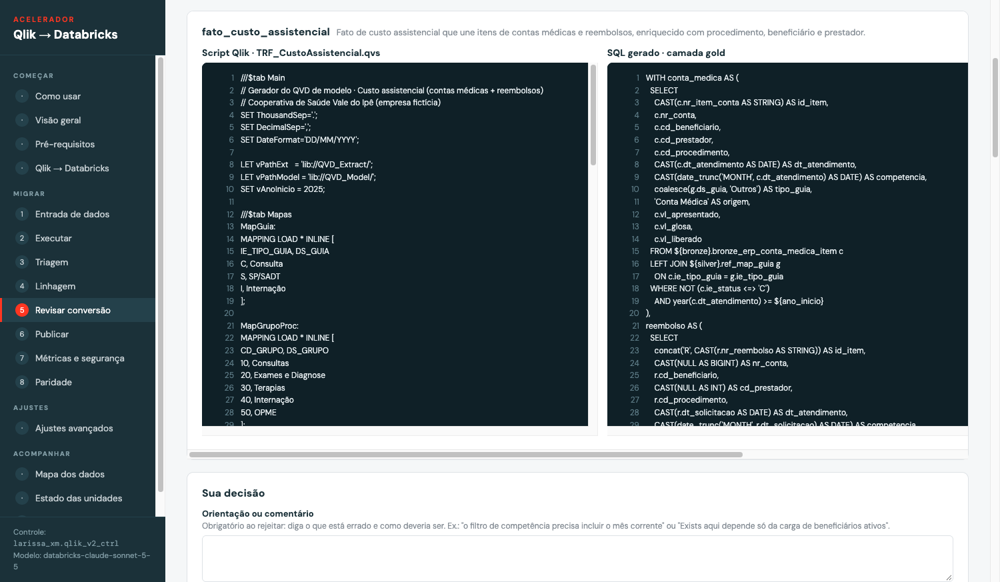
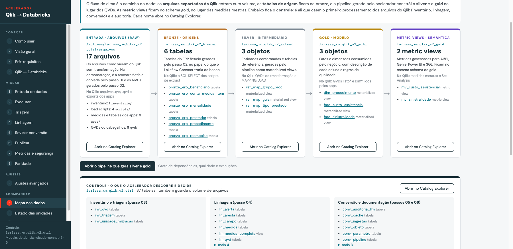
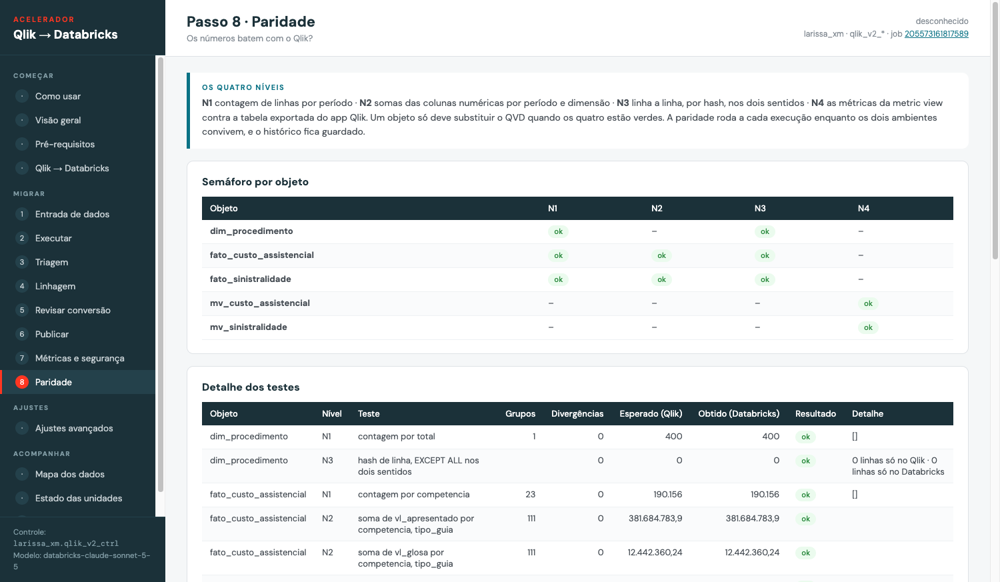

# dbx-qlik-migration-accelerator

Acelerador para migrar ambientes Qlik para o Databricks. Ele lê os scripts, QVDs e apps do Qlik, gera o código Databricks com IA, pede a sua aprovação quando a IA não tem certeza e compara os números com o Qlik antes de liberar cada tabela. Tudo é feito por um app no Databricks Apps.



## Sumário

1. [O que ele faz](#1-o-que-ele-faz)
2. [Requisitos](#2-requisitos)
3. [Instalar](#3-instalar)
4. [Migrar o seu ambiente Qlik](#4-migrar-o-seu-ambiente-qlik)
5. [Onde ficam os dados](#5-onde-ficam-os-dados)
6. [Segurança e governança](#6-segurança-e-governança)
7. [Configuração](#7-configuração)
8. [Problemas comuns](#8-problemas-comuns)
9. [Limitações conhecidas](#9-limitações-conhecidas)
10. [Desinstalar](#10-desinstalar)
11. [Estrutura do repositório](#11-estrutura-do-repositório)

## 1. O que ele faz

São 8 passos, executados por um job serverless e acompanhados pelo app:

| Passo | O que faz |
|---|---|
| 1 · Preparar | Cria schemas, volume e tabelas de controle, e dá ao app as permissões que ele precisa |
| 2 · Simular Qlik | Só no modo demonstração: gera um ERP e QVDs fictícios |
| 3 · Triagem | Lê o inventário de QVDs e separa o que migrar, revisar, arquivar ou descartar |
| 4 · Linhagem | Rastreia cada medida dos apps até a coluna de origem e define o escopo mínimo |
| 5 · Conversão com IA | Gera SQL Databricks, valida em sandbox e dá uma nota de 0 a 100. Abaixo de 85, você revisa |
| 6 · Publicar | Cria o pipeline com o que foi aprovado e um bundle para dev, hml e prd |
| 7 · Métricas e segurança | Medidas mestras viram metric views; Section Access vira row filter |
| 8 · Paridade | Compara com o Qlik: contagem, somas, linha a linha e métricas dos apps |

A IA recebe só scripts e nomes de tabelas e colunas, nunca dados. Nada é publicado sem passar por validação, e todo código rejeitado volta para a IA com a sua orientação.

<table>
<tr>
<td><br><sub>Entrada de dados: modo, origens e pasta dos arquivos</sub></td>
<td><br><sub>Revisão: script Qlik e SQL gerado lado a lado</sub></td>
</tr>
<tr>
<td><br><sub>Mapa dos dados: cada camada com link para o catálogo</sub></td>
<td><br><sub>Paridade: os números batem com o Qlik?</sub></td>
</tr>
</table>

## 2. Requisitos

- Um workspace Databricks com Unity Catalog, Databricks Apps e compute serverless habilitados.
- Um catálogo onde você possa criar schemas. Se você não for o dono do catálogo, o passo 1 mostra os comandos de permissão para o dono rodar.
- Um SQL warehouse (o menor tamanho basta).
- Um endpoint de modelo de IA em Serving, por exemplo `databricks-claude-sonnet-5-5`.
- Acesso ao PyPI a partir do serverless: os passos 2 e 8 instalam a biblioteca `pyqvd`.

## 3. Instalar

Há três formas de instalar. Todas criam o app `qlik-acelerador` e o job `qlik-acelerador-fluxo`. O nome do job acompanha o nome do app, então dá para ter mais de uma instalação no mesmo workspace.

### Caminho A · Pelo workspace

1. Em **Workspace → Create → Git folder**, cole a URL deste repositório.
2. Abra o notebook `instalar/Instalar_pelo_workspace`, conecte em Serverless e clique em **Run all**.
3. Preencha o catálogo no topo da página. O warehouse e o modelo aparecem em listas para escolher.
4. Clique em **Run all** de novo. Em 5 a 10 minutos aparece o link do app.

### Caminho B · Pelo terminal, com instalação guiada

Precisa da [Databricks CLI](https://docs.databricks.com/dev-tools/cli/install.html) e de `python3`.

```bash
git clone https://github.com/laryxm/dbx-qlik-migration-accelerator.git
cd dbx-qlik-migration-accelerator
./instalar/instalar.sh
```

O script mostra os catálogos, warehouses e modelos disponíveis, instala tudo e devolve o link do app.

### Caminho C · Com Databricks Asset Bundles

```bash
databricks bundle deploy -p <perfil> --var="catalogo=<catalogo>" --var="warehouse_id=<id>"
databricks bundle run acelerador -p <perfil> --var="catalogo=<catalogo>" --var="warehouse_id=<id>"
databricks bundle run acelerador_fluxo --only 01_preparar_ambiente -p <perfil> --var="catalogo=<catalogo>" --var="warehouse_id=<id>"
```

Variáveis opcionais: `prefixo_schema` (padrão `qlik_acel`), `modelo` (padrão `databricks-claude-sonnet-5-5`) e `app_nome` (padrão `qlik-acelerador`).

Depois de instalar, abra o app e comece pela aba **Como usar**. Para conhecer o fluxo sem dados do cliente, use o modo **Demonstração** e execute todos os passos. A demonstração usa uma empresa fictícia e leva cerca de 12 minutos.

## 4. Migrar o seu ambiente Qlik

### O que exportar do Qlik

Não é preciso exportar todos os QVDs:

| Arquivo | De quais | Para quê |
|---|---|---|
| `inventario*.csv` (colunas `nome, espaco, linhas, tamanho_bytes, atualizado_em`) | todos os QVDs, só a lista | triagem |
| `NomeDoApp.qvs` | os scripts da onda | linhagem e conversão |
| `*.qvd`, só o cabeçalho | os QVDs que esses scripts gravam e leem | colunas, contagem e linhagem |
| `*.qvd` completo | só os QVDs que os apps da onda leem | paridade linha a linha |
| `NomeDoApp_medidas.json` | os apps da onda | metric views e paridade das métricas |
| `hypercube*.csv` (separador `;`, decimal `,`) | uma tabela por visão importante do app | paridade das métricas |

Os QVDs de extração não precisam vir completos, porque os dados de origem chegam pelo Lakeflow Connect, direto do banco. O formato do arquivo de medidas está em `src/qlik_amostra/apps/`.

### O que configurar no app

Na aba **1 · Entrada de dados**:

1. **Modo:** escolha Ambiente do cliente.
2. **Tabelas de origem:** informe o `catálogo.schema` onde o Lakeflow Connect grava os dados. Se ainda não houver ingestão, o acelerador entrega a triagem, a linhagem e a especificação de ingestão de cada tabela.
3. **Pasta de entrada:** envie os arquivos pelo app (um .zip resolve) ou informe o volume onde eles já estão.
4. **Onda:** dê um nome ao lote que está sendo migrado agora, como `onda_1_custo_assistencial`. Esse nome vira tag em tudo o que for criado.

Depois, siga as abas na ordem numerada.

Para a paridade ser justa, a recarga do Qlik e a ingestão das origens precisam ter a mesma data de corte. Outra opção é comparar só períodos fechados.

## 5. Onde ficam os dados

A aba **Mapa dos dados** mostra cada camada com link para o Catalog Explorer. Com o prefixo padrão:

| Camada | Onde fica | No Qlik |
|---|---|---|
| Entrada | volume `/Volumes/<catalogo>/qlik_acel_ctrl/arquivos`, ou o volume que você informar | arquivos .qvs, .qvd e exports |
| Bronze | `<catalogo>.qlik_acel_bronze`, ou o schema do Lakeflow Connect | SQL SELECT dos scripts de extração |
| Silver | `<catalogo>.qlik_acel_silver` | QVDs de transformação e MAPPING LOAD |
| Gold | `<catalogo>.qlik_acel_gold` | QVDs Fato* e Dim* |
| Metric views | `<catalogo>.qlik_acel_gold` (`mv_*`) | medidas mestras |
| Controle | `<catalogo>.qlik_acel_ctrl` | inventário, linhagem, conversão, paridade e auditoria |
| Sandbox | `<catalogo>.qlik_acel_sandbox` | testes do código gerado |

## 6. Segurança e governança

- O repositório não guarda nenhuma credencial. O app usa o service principal que o Databricks Apps cria para ele, e a instalação usa o seu login.
- O passo 1 concede ao app só o necessário:
  - `USE CATALOG` no catálogo;
  - leitura e escrita no schema de controle e no volume;
  - leitura em bronze, silver, gold e sandbox.
- A IA roda no Model Serving do próprio workspace e recebe apenas metadados.
- Todas as ações ficam registradas no schema de controle:
  - `evento`: o que aconteceu, quando e por quem;
  - `unidade_status`: o estado de cada tabela, objeto e medida;
  - `aprovacao`: quem aprovou o quê;
  - `conv_auditoria_llm`: cada chamada à IA, com os tokens.

  As chamadas à IA também ficam no MLflow.
- Tudo o que o acelerador cria recebe as tags `onda` e `gerado_por`. Assim dá para ver o custo por onda em `system.billing.usage`.

## 7. Configuração

Os padrões ficam em `src/config/acelerador.yml`, com um comentário em cada linha. As mudanças feitas no app, em **Entrada de dados** e **Ajustes avançados**, valem a partir da próxima execução. Catálogo, prefixo, onda, modo e modelo também podem ser passados como parâmetros do job.

## 8. Problemas comuns

| Sintoma | O que fazer |
|---|---|
| Item vermelho em Pré-requisitos | A tela mostra o comando ou a ação para resolver |
| O passo 1 não conseguiu dar as permissões | Peça ao dono do catálogo para rodar os `GRANT` listados na saída do job |
| O passo 5 falha com 403 ou "endpoint not found" | Use outro modelo, em Ajustes avançados → IA ou na variável `modelo` |
| Os passos 2 ou 8 falham no `pip install` | Libere o PyPI no serverless ou configure um repositório interno |
| O app mostra a versão antiga | Recarregue a página com Cmd+Shift+R (no Windows, Ctrl+F5) |

## 9. Limitações conhecidas

- Com só o cabeçalho do QVD, os passos 4 e 5 funcionam, mas o passo 8 ainda precisa do QVD completo.
- O acelerador processa todos os scripts da pasta de entrada. Para migrar por ondas, envie os scripts de uma onda por vez ou use uma pasta para cada onda.
- Ainda não existe um kit que exporte os arquivos direto do Qlik.
- Expressões que dependem da seleção do usuário no Qlik são convertidas com ressalva e marcadas para revisão.

## 10. Desinstalar

```bash
databricks bundle destroy -p <perfil> --var="catalogo=<catalogo>" --var="warehouse_id=<id>"
```

Esse comando não apaga os schemas. Para remover os dados, rode `DROP SCHEMA <catalogo>.qlik_acel_<camada> CASCADE` para cada uma das camadas: `ctrl`, `bronze`, `silver`, `gold` e `sandbox`.

Se você instalou pelo Caminho A, apague manualmente o app, o job `<app>-fluxo` e o pipeline cujo nome termina em `_demo`.

## 11. Estrutura do repositório

```
databricks.yml        bundle e variáveis da instalação
resources/            definição do job e do app
src/                  os 8 passos, a configuração e a amostra fictícia
app/                  o app (FastAPI + HTML)
instalar/             instalação guiada (instalar.sh) e por notebook
docs/                 diagrama e imagens
```

## Licença

[Apache 2.0](LICENSE). Este é um projeto independente, sem suporte oficial da Databricks. Revise o código gerado e os resultados da paridade antes de usar em produção.
